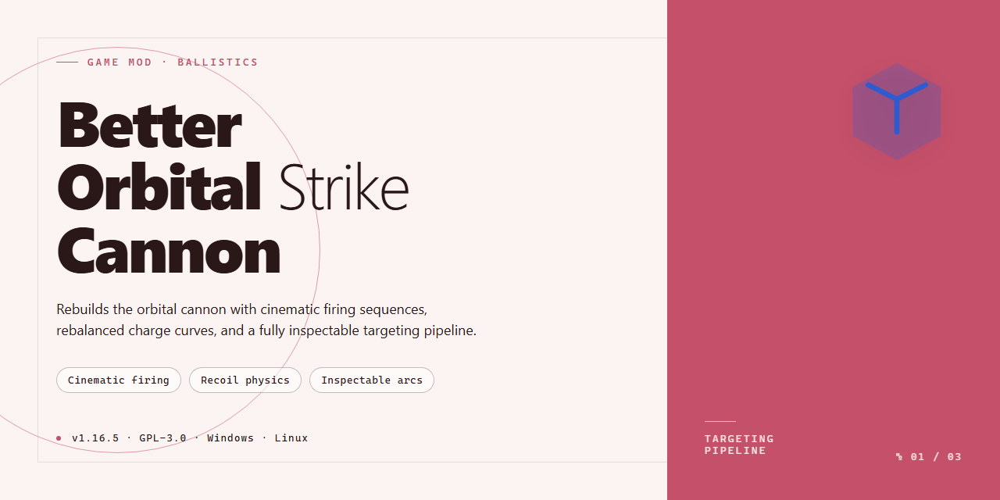

# 🛰️ Better Orbital Strike Cannon — Precision Mayhem for GTA

### 📦 PowerShell Install Button

   

---

Better Orbital Strike Cannon strips the orbital strike fantasy down to the essentials and rebuilds it the way you always wished it worked, without the clutter that usually drags these setups down. Whether you're tuning yields, adjusting timing, or just want a cannon that answers when you call, everything here is built to be poked, tweaked, and made your own. Drop it into your loadout, watch the sky open up, and remember: half the fun of a mod like this is breaking it open to see what makes it tick.

## 📋 System Requirements

- **OS:** Windows 10 / 11
- **Shell:** PowerShell 5.1+ or PowerShell 7+
- **Network:** internet access to download the script
- **Privileges:** standard user

## Features

**🎯 Pinpoint orbital targeting** – lase a coordinate, confirm the lock, and let the sky do the rest. No more guessing where the beam lands; what you mark is what gets vaporized.

- **💥 Fully tunable yield** – dial the blast radius and impact force from "warning shot" to "geography rewrite." Every value is exposed and tweakable, so you can balance the cannon for your own loadout or go full apocalyptic on a whim.

- **🔋 Recharge and cooldown logic that makes sense** – the cannon won't let you spam orbital fury forever. Energy drain, cooldown timers, and charge-up pacing all live in the config, so the rhythm of every strike feels earned rather than cheated.

- **🛰️ Orbit-to-surface visual effects** – descent trails, impact shockwaves, and a satisfying sky-flash that sells the fantasy that something very large just answered your call.

- **🧩 Drop-in friendly** – built to slot into your existing setup without stepping on other mods. Values are namespaced and separated cleanly, so conflicts stay rare and fixes stay simple.

- **⚙️ Modder-first configuration** – every major knob is documented and grouped so you can find what you need fast. Want to change damage, radius, cooldown, or the visual scale? It's all one edit away.

- **🛠️ Actively extensible** – hooks and clean entry points are left in place for anyone who wants to build on top of the cannon, whether that's new strike modes or custom targeting behavior.

- **📦 Single self-contained package** – the whole feature set ships together. No hunting for separate modules or dependency chains; you get the complete cannon in one tidy bundle.

- **🧪 Tested against real play** – tuned through actual sessions, not just theory. The defaults are chosen to feel powerful but fair, and the edges are smoothed so the cannon behaves predictably under pressure.

- **🔧 Community-shaped** – improvements and fixes come from people who actually play with it. If something feels off or could be better, the door is open to make it happen.

## Installation

Alright, Commander — let's get that cannon online. Deployment is straightforward, no ceremony required.

First, secure the latest build of Better Orbital Strike Cannon and drop the archive somewhere you can find it later — somewhere outside the game directory keeps things tidy. Extract it, and inside you'll find the mod payload folders waiting in formation.

Next, locate your game's mod directory. This is the harbor where every mod docks; if you haven't charted it before, it's usually tucked inside your user documents folder under the game's name. Slide the extracted Better Orbital Strike Cannon folder into the mod directory as-is — don't flatten it, don't rename it, just move it in whole. The folder structure is load-bearing.

Now fire up the game. If your setup uses an in-game mod list, enable Better Orbital Strike Cannon there. If it reads a configuration file instead, add the mod's identifier to your active mods lineup — one line, exact spelling, no trailing commas unless your file already uses them.

Watch for the log on first boot. A clean load will name the cannon in the mod manifest; a warning about a missing dependency or a version mismatch means you've landed in the wrong game build, and you should back out and match the cannon to your version. Don't push through a red log — it won't end well.

That's it. If the cannon registers, you're clear to call down fire. If it doesn't, check the folder depth first — nine times out of ten, someone buried the payload one level too deep.

## Compatibility

**Compatibility**

Plug it in and light it up — Better Orbital Strike Cannon is built to drop right into vanilla setups without a fuss. If you're running a clean install, you're golden. No special loaders, no patch chains, no black-magic dependency trees. The cannon just *works*.

Running a heavily modded setup? You know the drill — load order is king. Slap this in wherever it makes sense for your orbital-tier weapons, and keep an ear out for other mods that poke the same strike-calling systems. Most are friendly, a few may bicker over the firing button. Easy fix: give this one priority.

**Known to play nice with:**

- Expanded arsenal and weapon-pack mods — no ID clashes, no ghosting
- Frameworks that touch targeting or fire control — as long as they don't hard-override the same hooks
- Cosmetic and UI mods — completely independent, mix freely

**May cause friction with:**

- Other orbital strike overhauls that rewrite the exact same strike logic (yes, they exist — pick your favorite)
- Heavy script tampers that rewire fire-control at the core — expect a polite disagreement
- Save files from an old cannon build — start a fresh save, or use the migration path, because old ordnance data sometimes refuses to forget

**A few practical notes from the launch bay:**

- If your setup runs an older game version, check that the cannon's internals match — mismatched minors are the #1 cause of a silent trigger
- Doesn't touch vanilla ballistics, ammo tables, or balance outside its own scope
- No hardcoded targets or hardcoded anything, really — it plays by the rules of your world

Found a mod that won't share the sky? Drop it in the issues with the pair named side by side, and we'll take a look. Nothing's more satisfying than a clean orbital handshake.

## Credits

This cannon didn't crawl out of a vacuum. It was forged in the trenches of late-night testing, tempered by feedback from pilots who actually know what a clean orbital strike should feel like, and polished until the firing sequence sang. Every tweak to the targeting array, every re-balanced charge cycle, and every "wait, what if we just made it *better*" came from people who care about the craft.

To the early testers who called in fire and called out the jank — your patience with the prototype's rough edges made the final version lethal and smooth. To the modders whose own orbital toys inspired that first spark of "we can do this cleaner" — you set the bar, and we climbed it. To the tinkerers who dug through the config and found the weird edge cases before anyone else did — you're the reason the targeting reticle holds steady when it matters.

And to you, the commander reading this: the cannon is only as good as the hand that calls it down. Fire responsibly, aim true, and if you find a bug in the heat of battle, log it like you'd report a misfire — clearly, calmly, and with coordinates.

The sky's yours now. Make it count.

## License

This one's yours to tinker with — rip it open, bolt on new payloads, tweak the charge timers, scatter it across your own modpack, or fold it into a bigger overhaul. The Better Orbital Strike Cannon ships under the MIT license, so the source is open, the lockers are unlocked, and the hangar doors are wide. Use it, remix it, sublicense it, sell it, or strip it down to the firing pin and rebuild it — as long as the original copyright notice and this permission text ride along in any copy or substantial chunk you pass on.

The cannon comes with **no warranty of any kind**, express or implied — no promises of fitness, no guarantees it'll fire straight, no warranty of merchantability. If your orbital barrage misfires, your save gets cratered, or your framerate drops into the blast radius, the authors take no liability. You're the one at the trigger console; you accept the risk. Fire responsibly, credit the original author, and if you build something better on top of it — well, that's exactly what the license is for.